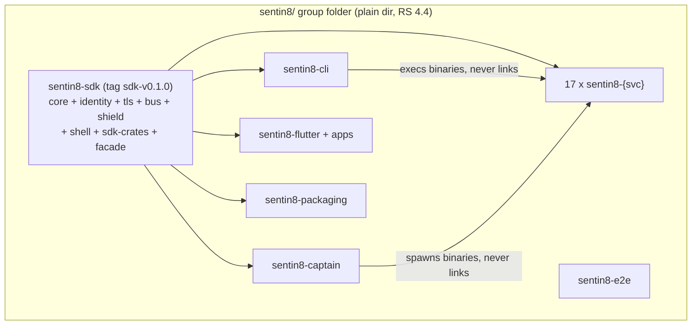
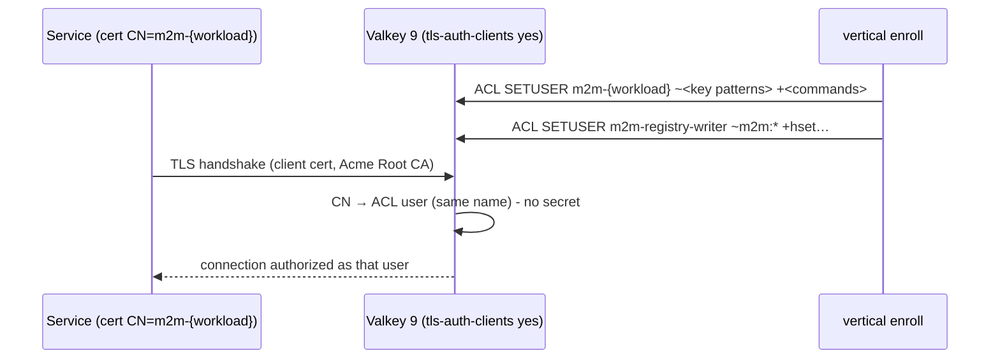
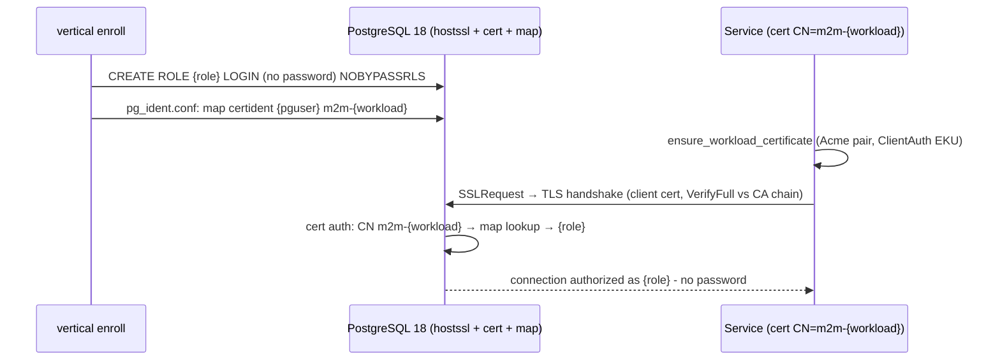

# sentin8/ Platform Group - Detailed Design

> **Audience**: maintainers and architects modifying the platform group.
> For the overview read `README.md`; for business scope read `BUSINESS.md`.
> The repository-split design of record is
> `../design/sentin8-repository-split-design.md` (RS).

## 1. Scope & Context

The platform group owns the entire **shared plane** of the tree: the SDK
workspace (`sentin8-sdk`), the starters, the 17 platform services, the
Flutter package + platform apps, e2e, and packaging. It is the bottom of
the repo DAG - vertical groups consume it exclusively through the
`sentin8` facade git pin (RS §2.3), never through local paths.



## 2. Runtime Architecture

Boot & run order follows RS §5 (design of record): captain spawns before
any service; tiers are health-gated (D6: each tier waits for `Active`,
bounded by `SENTIN8_CAPTAIN_TIER_GATE_TIMEOUT`, default 60s).

```
tier 1  acme            tier 4  db storage post cron stat secrets func flow ai
tier 2  auth, proxy     tier 5  sys, app
tier 3  bus             tier 6  bff, web
```

Hard boot dependencies (fatal): PostgreSQL for every service; Valkey for
`bus`, `stat`, `bff`, `captain` (proxy degrades to poll). Everything
cross-service is fail-open at boot (outbox rows park; DCR retries every
3s in background).

## 3. The Infrastructure Contract (§2.2.1)

`docker-compose.yml` in THIS folder is the single dev infra for the whole
tree - PostgreSQL 18 (the platform DB `sentin8` + one database per
vertical, created by `sentin8-cli vertical init`) and Valkey (streams,
captain registry, MemBus, session store). Vertical groups carry **no**
compose files; their services reach the same localhost endpoints. This
mirrors production ownership: the platform operates the data plane.

### 3.1 Valkey certificate identity (auth DESIGN §4.3f)

The Valkey plane runs on **certificate identity** - the same Acme-issued
workload certificate that authenticates service→service calls (§4.3f)
also authenticates service→Valkey connections:



- **Transport**: the TLS listener presents an Acme server cert; clients
  present their workload cert; `tls-auth-clients yes` - no certificate,
  no connection. The plaintext listener is retained ONLY on the container
  loopback for the local control path (captain, dev tooling).
- **Authentication**: Valkey 9 maps the client cert's CN to the ACL user
  of the same name. Workload names keep their colons (`m2m-sentin8:sys`)
  - verified accepted by ACL usernames. There are NO Valkey secrets.
- **Authorization**: `vertical enroll` provisions per-workload ACL users
  from the same service fragment that declares PG roles and registry-map
  entries (key patterns + command allowlists; zero core vertical
  knowledge, §4.14). The single `m2m-registry-writer` user is the ONLY
  identity with write rights on `m2m:workloads`/`m2m:declared` - the
  token-free authorization record is not writable by any service.
- **Client**: the SDK ships ONE cert-presenting Valkey client factory
  (`sentin8_middleware::valkey_client(workload)`); every
  client-construction site in the tree routes through it, passing the
  `service_type` each service already hardcodes in its `main.rs`. The
  default ACL user is reduced to read-only infra keys and the local
  control path.
- **GLIDE**: the client engine is **Valkey GLIDE** (`valkey-glide`,
  imported as `glide`) - the platform's mandated Valkey client. The
  factory constructs `GlideClient` with `TlsConfig::SecureTls`, the
  public CA chain (`tls_ca_cert`), and the workload's m2m pair
  (`client_identity`) - glide-core owns reconnection and backoff
  natively, absorbing the retry scaffolding the previous
  ConnectionManager-based client needed. The factory/membus/registry/
  discovery/metrics surfaces keep their method shapes (GLIDE mirrors
  the typed-command API) so call sites migrate mechanically.
- **URL derivation (VALKEYDERIVE-1)**: a Valkey URL under certificate
  identity is pure structure - scheme + host + port; the client
  certificate authenticates and the per-workload ACL namespaces
  authorize, so no secret component exists. The URL the SDK factory
  receives DERIVES from the plane: `sentin8_config::
  service_valkey_url()` builds `valkeys://{SENTIN8_VALKEY_HOST}:
  {SENTIN8_VALKEY_PORT}/0` (defaults `localhost:6379`). The `/0` suffix
  is explicit-but-inert - `valkey_client`'s `parse_host_port` discards
  the number and GLIDE connects at its default DB 0; the historical
  `SENTIN8_{AUTH,BFF,STAT}_VALKEY_URL=/1|/2|/3` lines were
  inoperative and are retired. Logical-DB isolation was never the
  mechanism - the ACL key namespaces (`~{ns}:*` per workload, §3.1
  authorization) are and remain the only isolation boundary. Call
  sites resolve: explicit `{SERVICE}_VALKEY_URL` env var (override)
  → else the derived URL; the four Valkey env lines retire from the
  operator `.env` (captain propagates the host/port vars instead).

### 3.2 PostgreSQL certificate identity (PGMTLS-1)

The PostgreSQL plane runs on the SAME certificate-identity model as
Valkey §3.1 - the Acme-issued workload certificate authenticates the
service→PostgreSQL connection; there are no database passwords. The
mapping from certificate identity to PostgreSQL role is
**registration-driven**, provisioned by `vertical enroll` from each
service's own `--print-registration --section=pg_roles` fragment, so the
platform core carries zero knowledge of future verticals (§4.14) - the
enroll loop that already creates the role also binds the cert identity
to it, in the same pass.



- **Transport**: TLS-only, mirroring Valkey. `ssl=on` with the Acme
  server leaf (`postgres-server.crt`/`.key`, CN `infra-postgres`,
  SANs `localhost` + loopback IPs - same profile as `infra-valkey`),
  `hostssl` only in `pg_hba.conf` (no `host` lines at all), and the
  client cert REQUIRED (`clientcert=verify-full` semantics via the
  `cert` auth method). A plaintext listener does not exist; sqlx's
  `PgSslMode::VerifyFull` refuses downgrade.
- **Authentication**: `pg_hba.conf` uses the `cert` method - the
  connection's PostgreSQL role is decided purely by the certificate.
  `pg_ident.conf` carries one `pgm` map whose rows are written by
  `vertical enroll` (and `db bootstrap` for platform roles) as plain
  text rows - PostgreSQL parses both files only at startup and on SIGHUP
  (`pg_reload_conf()`), so the enroll write ARMS the map by running
  `SELECT pg_reload_conf()` over the operator identity right after the
  write (a written-but-never-reloaded row is dead). The
  `pg_hba_file_rules`/`pg_ident_file_mappings` views re-parse for
  display only - they are NOT evidence of the active parse.
- **Authorization**: unchanged from DBX - roles stay `NOBYPASSRLS`,
  RLS stays mandatory, per-database CONNECT remains revoked from
  vertical roles. Certificate identity REPLACES the SCRAM placeholder
  password; it adds nothing to authorization.
- **Identity binding is vertical-agnostic**: the map row derives from
  the service's declared `PgRole.role` + the workload name the service
  already self-describes (`service_type` in the registration JSON).
  Enroll creates role + map row in one pass; `bank8_ledger_service`
  binds to `m2m-bank8:ledger` without any platform code knowing
  `bank8` exists.
- **Client**: `sentin8_config::pg_pool::connect` becomes the single
  cert-presenting factory (mirroring `sentin8_middleware::valkey_client`)
  - every DB connect site in the tree routes through it. It resolves
  the workload pair (`SENTIN8_M2M_CREDENTIALS_DIR`, infra-tls fallback
  for fixed identities) and the public CA chain, builds
  `PgConnectOptions` with `VerifyFull` + root CA + client identity,
  and REJECTS DSNs carrying a password component - a password-bearing
  DSN is a misconfiguration, not a degraded mode.
- **SQLX feature**: every workspace `Cargo.toml` enables sqlx's
  `tls-rustls-ring` feature (sqlx 0.8 compiles NO TLS support without
  it; DSNs may gain `sslmode=verify-full`).
- **DSN derivation (DSNDERIVE-1)**: under certificate identity a
  service DSN is PURE STRUCTURE - role + host + database, no secret -
  so every service's DSN derives from the `service_type` it already
  hardcodes in `main.rs`: `sentin8_config::service_database_url(
  service_type)` builds `postgres://{role}@{host}:{port}/{vertical}`
  (role = canonical identity with `:`→`_` + `_service`, `:worker`
  segments resolving to the parent role; database =
  `expected_database_name` - the vertical, VDC §VDC.3; host/port from
  `SENTIN8_PG_HOST`/`SENTIN8_PG_PORT`, defaults `localhost`/`5432`).
  `ShellConfig::from_env` resolution order: explicit
  `{SERVICE}_DATABASE_URL` env var (override, highest precedence) →
  else the derived DSN. The wrong-database guard stays as the
  belt-and-suspenders check on whatever resolved. Consequence: a
  vertical needs ZERO DSN lines in the operator `.env` (the per-service
  `*_DATABASE_URL` blocks are retired from `.env`/`.env.example`;
  captain's catalog-declared `database_env_vars` propagation stays as
  the override channel for custom topologies), and a future vertical
  wires its database plane by enrolling alone (§4.14 parity).
- **Boot order**: `make infra-tls` (offline mint: postgres server leaf +
  `postgres-ops` operator pair + pg_hba/pg_ident seed files) →
  `make infra-up` (PostgreSQL starts TLS-only) → `db bootstrap` /
  `vertical init` (roles + map rows) → `make start` (fleet).
- **Bootstrap tier**: `db bootstrap` and operator tooling connect as
  the DDL-only superuser via the `postgres-ops` infra pair (CN
  `m2m-postgres-ops`, an operator-held identity like `valkey-admin`)
  mapped to role `sentin8`; `DATABASE_URL`'s password component is
  retired.
- **Shield substrate grants (platform DB)**: the Shield runtime's
  sync-reload-on-empty-coverage self-heal (`shield/src/runtime.rs`) may
  run INSIDE any platform service's request path - it seeds the env's
  template policy sets through the CALLING service's own pool + role
  (`sentin8_set_tenant_context` + `INSERT INTO sys.policy_sets`). The
  enroll platform-grants block therefore converges
  `GRANT SELECT, INSERT, UPDATE ON sys.policy_sets` to every
  `sentin8_%_service` platform role (mirroring the vertical substrate's
  VDC-6 loop - auth's provisioning endpoint exercises it at env
  creation, before the event-driven env-init refresh lands).
- **Client cert EKU**: the m2m workload pairs already carry `ClientAuth`
  EKU (`sign_client_leaf`) - PostgreSQL's client-cert verification
  accepts them unchanged.

#### 3.2.1 Files on disk (target state)

| File | Owner | Purpose |
|---|---|---|
| `{secrets}/infra-tls/postgres-server.crt/.key` | `make infra-tls` | PostgreSQL TLS server leaf |
| `{secrets}/infra-tls/postgres-ops.crt/.key` | `make infra-tls` | Operator/DDL identity (map → `sentin8` superuser) |
| `{secrets}/infra-tls/pg_hba.conf` | `make infra-tls` | TLS-only HBA (hostssl+cert, local trust) |
| `{secrets}/infra-tls/pg_ident.conf` | `make infra-tls` + enroll | CN→role map (`pgm`), registration-driven |
| `{secrets}/acme-ca/root-ca.crt` | `make infra-tls` | Published root+intermediate chain |
| `{secrets}/m2m-credentials/{workload}.crt/.key` | m2m mint loop | Per-workload client pairs |

#### 3.2.2 Boot & tooling paths

- `sentin8-cli db bootstrap` presents the `postgres-ops` pair via the
  SDK factory.
- `vertical init` / `vertical enroll` / `dev-destroy.sh` use the same
  `postgres-ops` identity for the maintenance connection (the same role
  the bootstrap tier uses today - passwordless now).
- The compose healthcheck stays `pg_isready` (no auth performed).
- `sentin8-cli infra` status line connects via the factory as the
  `postgres-ops` identity (read-only summary).
- sqlx compile-time macros (`sqlx::query!`) are NOT affected - every
  repo ships committed `.sqlx` offline caches; builds never connect.

#### 3.2.3 Rejected alternatives

- **PostgreSQL 18 OAuth (OAUTHBEARER)** - requires an
  `oauth_validator_libraries` module (does not exist in the repo, is
  not shipped by the image) and sqlx has no OAUTHBEARER client support.
  mTLS achieves the same per-service role isolation with the existing
  Acme plane.
- **mTLS transport + SCRAM password** - keeps a shared plaintext secret
  on every role, defeating the point of certificate identity (the
  Valkey precedent set: no secrets on the data plane).
- **Static per-service `pg_ident.conf` rows in core** - reintroduces
  per-service knowledge into the platform, violating §4.14. The map is
  registration-driven.

#### 3.2.4 Renewal

Workload pairs (30d) and infra leaves (90d) renew inside their existing
windows (`ensure_workload_certificate` 7-day window; infra 14-day). Pools
re-handshake on reconnect; `pg_hba.conf`/`pg_ident.conf` changes arm on
the next SIGHUP (every CLI write reloads), so rotation never needs a
server restart.

## 4. Data Model

The platform owns database `sentin8`, schema-per-service (`auth`, `bus`,
`sys`, …), RLS on every tenant table, plus the enroll-provisioned per-
vertical databases (`bank8`, `hotel8`, …). The CLI repo owns
`migrations/platform.sql` (roles, schemas, grants); each service repo owns
its `sql/init.sql` (schema + outbox + audit journal). Per-repo `.sqlx`
offline caches are committed - consumer builds need no live PG.

## 5. Cross-Cutting Concerns

- **Auth**: every service verifies Sentin8:Auth tokens; platform workloads
  authenticate by certificate (auth DESIGN §4.3f - the TLS handshake presents
  the Acme-issued pair; the registry map authorizes) via the `sentin8-m2m`
  crate in the SDK.
- **Shield**: authorization step-5 engine `sentin8-shield` (renamed from
  `sentin8-policy`, RS §2.4) - policy-as-data terms unchanged.
- **Eventing**: producers write local `{service}.outbox`; post-commit
  relays push to Bus `POST /v1/produce`. D1 removed the last direct
  `bus.inbox` writer (acme); D4 made 429/408 retryable.
- **Enrollment**: composable - every repo ships
  `service-registration.json`; `sentin8-cli vertical enroll <path>…`
  merges fragments per vertical (RS §6).

## 6. Failure Modes & Recovery

A Bus outage parks outbox rows locally (retry + backoff, capped at
`RELAY_MAX_ATTEMPTS`, manual replay after). A Sys outage parks audit
journal rows. Acme unavailability delays only first-TLS-handshakes
(negative-cache backoff). Captain's tier gate degrades to proceed-with-
warning on timeout - never a boot hang (D6).

## 7. Invariants

- Starters link no service binary - they exec/spawn them (RS-2).
- A service repo's `Cargo.toml` carries zero path deps (RS-5).
- The SDK plane contains no service binary and no registration file
  (RS-6).
- The group folder is a plain directory - never a git repo or workspace.

## 8. Testing Strategy

SDK + starters: unit suites in-repo (`make test`). Services: each repo's
own unit/integration suites (auth 193, captain 14 tests green at split).
Cross-service flows: `sentin8-e2e` (Playwright, UI-only per AGENTS.md).

## 9. Open Questions

- RS-4 (D7 owner-API conversions) - see the split backlog.

---

**Design attribution:** sentin8 and its underlying concepts were designed by Hamid Jahanzad <Hamid@Jahanzad.com>.
